# dsh-grok-buddy

<p align="center">
  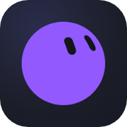
</p>

<h3 align="center">把 Grok Bot 本人那张脸，装进 DeepSeek Harness 的会话列表</h3>

<p align="center">
  每个会话在侧栏那一行，原来的彩色小圆点换成一只会呼吸的 GrokBot 头像。<br>
  它在思考、在跑工具、在等你点确认、失败了、还是刚干完 —— <b>看脸就知道</b>。
</p>

<p align="center">
  <a href="https://github.com/topics/dsh-plugin"></a>
  <a href="https://github.com/devzer0o0/dsh-grok-buddy/releases"></a>
  <a href="./LICENSE"></a>
  = 22">
</p>

<p align="center">
  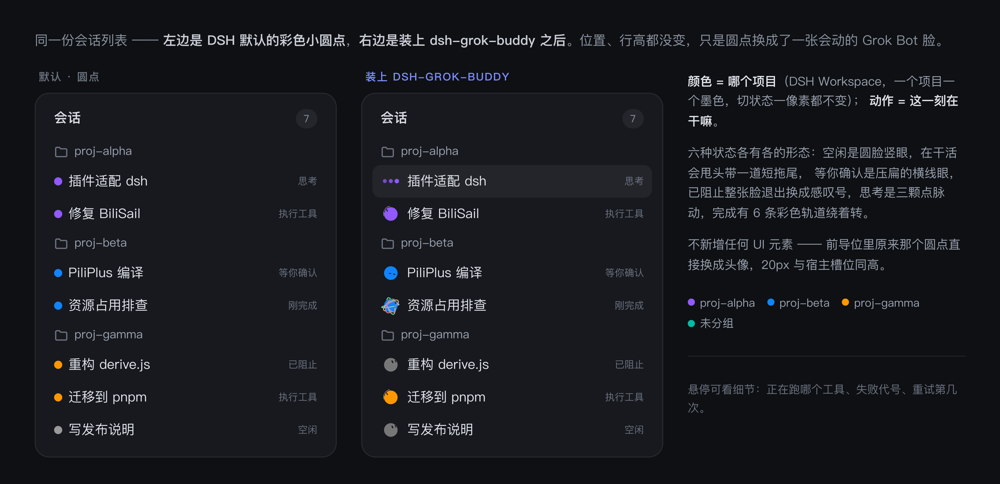
</p>

<p align="center"><sub>左边是 DSH 默认的彩色小圆点，右边是装上之后。位置、行高、槽位宽度都没变，只是圆点换成了一张脸。</sub></p>

---

## 这是什么

一句话：**DSH 侧栏里每个会话的状态，由 Grok Bot 那张脸来演。**

它没有另画一套图标，也不是随便找个 emoji 顶上去 —— 用的是 Grok Bot 自己的头像和表情：
一颗圆滚滚的 blob，两只眼睛贴在球面上，转头时会跟着透视变形、转到背面会消失；
表情切换是带弹簧的形变，平时还会随机眨眼。

<p align="center">
  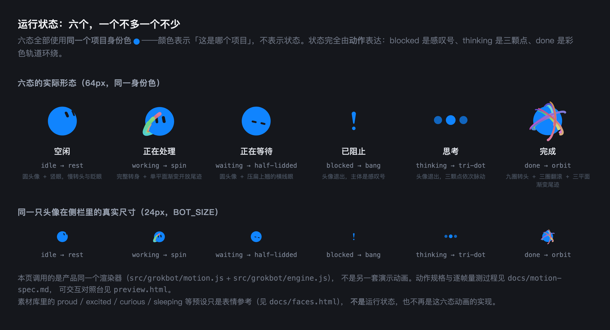
</p>

它真的会动 —— 下面这张是从产品渲染器逐帧抓下来的（不是示意图）：

<p align="center">
  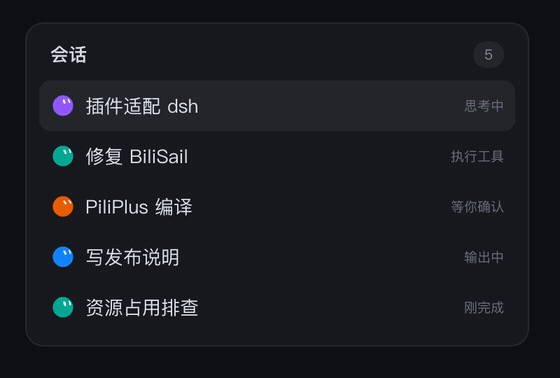
</p>

## 目录

- [这是什么](#这是什么)
- [为什么是这张脸](#为什么是这张脸)
- [三层分开：状态 / 动作 / 表情](#三层分开状态--动作--表情)
- [六态判定（唯一语义）](#六态判定唯一语义)
- [颜色是身份，动作是状态](#颜色是身份动作是状态)
- [界面适配：不是只有侧栏那一种行](#界面适配不是只有侧栏那一种行)
- [安装](#安装)
- [刷新、重启与验收](#刷新重启与验收三件事不一样)
- [诊断（默认关闭）](#诊断默认关闭)
- [工作原理](#工作原理)
- [开发](#开发)
- [未完成与已知边界](#未完成与已知边界)
- [致谢与许可](#致谢与许可)

## 为什么是这张脸

Grok Bot 的设计文章把这件事讲得很清楚：他们要解决的不是「怎么再塞一个进度指示器」，
而是「怎么让头像本身承担状态」。

> We could have represented each state with a separate indicator, but that would
> have added another layer of UI for the user to interpret. Instead, we explored
> how much of the lifecycle the avatar itself could carry.

所以这里也照做：**不新增任何 UI 元素**，只把侧栏原本那个彩色小圆点换成一个会呼吸的头像。
会话行高保持 32px，头像画布从 20px 适度放大到 **24px**（边长增加 20%）。
画布包含彩带的安全边距，因此头像本体从约 **13.3px 增至 16px**，不是把彩带裁掉来放大脸。
前导位同步扩展；有定时任务时钟时按「24px 头像 + 2px 间隔 + 16px 时钟」并排，标题顺延。

<p align="center">
  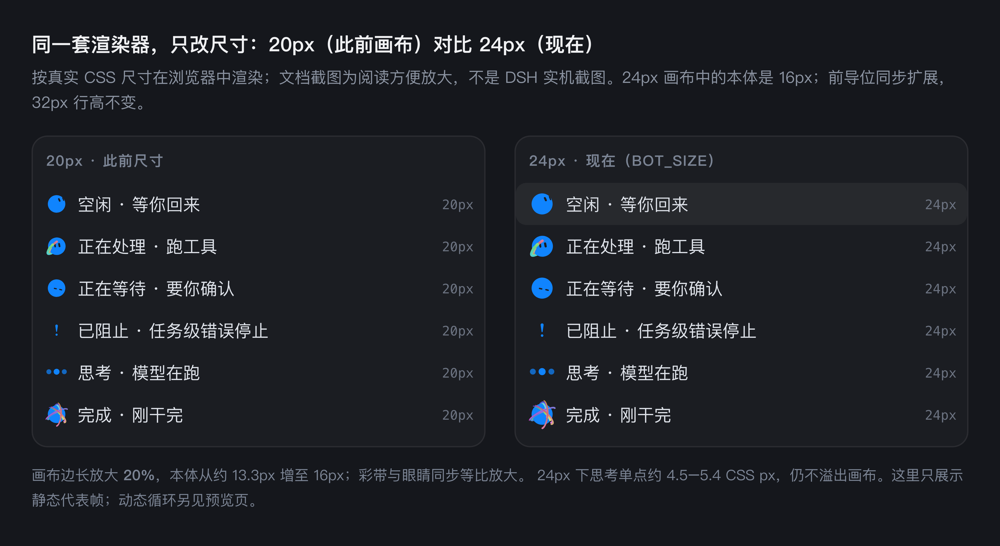
</p>

24px 下思考单点约 4.5–5.4 CSS px；彩带保留官网小尺寸加粗与前后遮挡。
原生项目文件夹仍是 16px，不受会话头像尺寸调整影响。

## 三层分开：状态 / 动作 / 表情

这是本插件最容易被误解的地方，先讲清楚：

| 层 | 是什么 | 出现在哪里 |
| --- | --- | --- |
| **运行状态**（runtimePhase / displayPhase） | **只有六种**：idle / working / waiting / blocked / thinking / done | 接口、文档、读屏标签、`data-dsgb-phase` |
| **动作**（motion） | 内部动画资源名：rest / spin / half-lidded / bang / tri-dot / orbit | `data-dsgb-motion`（明确标注是动画资源） |
| **图形构成**（figure） | 这一态画的是什么：avatar / avatar+trail / exclamation / dots / avatar+orbit | `data-dsgb-figure` |
| **表情素材**（expression） | 25 张眼型，只服务 idle / working / done 的眼睛造型 | 只在渲染引擎内部 |

所以：

* **素材库有多少条，不等于插件有多少种状态。** 素材库里还有 proud、excited、
  curious、sleeping 等二十多个预设，它们**不是**运行状态，也不再是六态动画的实现。
* **表情图里的名字，不等于运行状态。** [docs/faces.html](docs/faces.html) 里那些 sleeping /
  waking / searching / curious / proud 只是 idle 的表情素材参考，不参与会话状态判定。
* 事实与标志位（selected / seen / consumed / stale）也不是状态。

## 六态判定（唯一语义）

实现在 [src/decision.js](src/decision.js)，宿主与页面**共用这一份**，没有第二套优先级。

| 状态 | 中文 | 判定条件 |
| --- | --- | --- |
| idle | 空闲 | 默认；没有在途任务；或完成展示已结束/已被消费 |
| working | 正在处理 | 会话活跃，且**当前任务还有未结束的工具调用** |
| waiting | 正在等待 | 会话活跃，且有未解决的**审批、提问或计划评审** |
| blocked | 已阻止 | **当前任务已被确认因错误而停止**，且该停止尚未被真实恢复或新一轮取代 |
| thinking | 思考 | 会话活跃，处于模型请求/推理/生成阶段，且无更高优先级事实 |
| done | 完成 | 当前轮有明确的**成功**终态，且完成展示仍活跃、未被消费 |

### blocked = 任务级错误停止（不是「有错误」）

一句话定义：**当前会话的当前任务已被确认因错误停止执行，且这个停止事实还没有被
真实恢复执行或新一轮任务取代。**

它明确**不**表示：出现过错误 / 有一条 error 记录 / 某个工具调用失败 / 模型正在自动重试 /
暂时没有输出 / 网络看起来异常 / 用户主动取消。

事实分三层，代码里也分开存（[lib/fold.js](lib/fold.js)）：

| 层 | 字段 | 作用 |
| --- | --- | --- |
| A. 错误诊断 | `facts.error` | 某次工具/请求/重试报了什么错。**只用于日志与 tooltip，不参与判定** |
| B. 自动恢复 | `facts.retry` | 当前轮是否仍有有效的重试调度/正在重试。让任务保持 thinking |
| C. 任务级停止 | `facts.stop` | 哪一轮、因什么错、由哪个权威事实确认停下。**只有它能推出 blocked** |

### 判定顺序（不可交换）

1. **当前有效成功终态** → done（若已消费/已失活则 idle，**完成事实不删除**）。
2. **当前有效任务级错误停止** → blocked。
3. **当前有效非错误结束**（取消 / 截断 / 未知）→ idle。
4. 未终止且有挂起交互 → waiting。
5. 未终止且有未结束工具 → working。
6. 未终止且仍有**有效的自动重试** → thinking（先于静默，退避可能长于静默阈值）。
7. 未终止且模型在跑 → thinking。
8. 其余（含静默）→ idle。**沉默既不冒充 done，也不冒充 blocked。**

几条明确的边界：

* **仅模型输出、仅 agent running、仅等网络响应，都不等于 working。** working 只留给
  真正在运行的工具调用。模型吐字属于 thinking。
* **工具失败只是诊断**：一个工具报错、别的工具还在跑、Agent 继续分析、编译/测试失败后
  继续修复，都是 working / thinking，绝不闪 blocked。
* **自动重试不是停止**：进入退避、连续重试、重试开跑，全程 thinking；只有重试耗尽
  **并且**宿主用权威终态（`turn/end` reason=error）终结这一轮，才 blocked。
* **已确认的停止压过挂起交互**：执行器已经停下时，残留的审批/提问没有回答方；
  但**未确认**的停止绝不抢走 waiting。
* **用户取消不是错误停止**：`turn/end` reason=aborted 且 cause 是 user → idle。
* **静默与断线都不产生 blocked**。
* **完成展示失活，不等于忘记**：终态事实与展示状态分开保存。

### waiting 覆盖的真实来源

不是只支持审批。DSH 里「等人」有两类**互补**的真实来源，本插件两处都接：

| 来源 | 真实宿主契约 | 覆盖什么 |
| --- | --- | --- |
| 审批 | `approval/asked` ↔ `approval/decided` 事件对（带 `id`） | 所有需要批准的调用 |
| `userQuestions` 投影 | `sessionProjections.stateOf(session, 'userQuestions')` | **带 timeout** 的 `ask_user_question` 和计划评审 |
| 未结束的交互式工具调用 | `tool/call` 名为 `ask_user_question` / `exit_plan_mode` 且结果未回 | **阻塞式**提问与评审（它们根本不进投影） |

> **投影的 raw state ≠ wire view**。这是踩过的坑：
> `stateOf()` 返回 `{ inheritedEventCount, timed, questions: { active, settled } }`，
> 而 `state.active` 永远 undefined —— 读错就会把挂起提问算成 working。正确路径是 `state.questions.active`。

`active` 里两种状态都算「还要人回答」：`open`（正在等）与 `continued`
（带 timeout 的提问超时返回 pending，用户仍可回答）。

三种结果必须分开，不能都当「已解决」：

* 明确有挂起交互 → waiting
* 明确没有（投影返回空）→ 清掉投影来源
* 投影不可用或读取失败 → **保留**现有事实，不凭空清空

交互的解决事件必须匹配**当前有效交互的身份**（`id` / `callId` / 轮次），
不能只按事件类型清空 —— 旧轮的 `approval/decided` 曾把当前轮的新审批清掉。

### 完成展示（用户确认的规则）

> **活跃时持续庆祝；查看并切走或失活后变为灰色 idle。**

所以 done 路径上：

* 活跃完成期间**一直**做庆祝动作（orbit），**没有**固定 2.6 秒退回；
* 同一完成周期只初始化一次，持续播放期间不重复重启动画；
* 用户查看期间仍显示 done + 项目色；
* 查看后切走，或完成展示活跃期结束 → idle、灰、停止庆祝；
* 新一轮真实开始 → 进入新任务对应状态；
* 同一完成记录被消费后，旧 DOM / 旧快照的 done **不能**让它重新复活；
* 新一轮完成可以建立**新的**展示周期（completionKey 不同）。

完成身份按 `completionKey`（sessionId#turn）记，**不是**按会话 id 一刀切。
缺 completedAt 时用页面的「首次观测时刻」作稳定锚点，所以「无法标记已查看、
永远活跃」不会发生。

#### 「查看」与「消费」是两件事

踩过的坑：选中就立刻写 consumed，下一次同步就把 done 判成 idle ——
用户看到的是一闪而过的庆祝。现在严格分开：

| 事实 | 何时写入 | 效果 |
| --- | --- | --- |
| `viewedAt` | 该完成进入展示且该行**被选中** | 记录「用户在看了」，**不消费**，仍是 done + 项目色 |
| `consumedAt` | 已经 `viewedAt` 过，**且现在不再选中** | 这才是「查看后切走」→ 退出展示 → idle、灰 |

「查看」的证据是侧栏的选择状态（`aria-selected`，DSH 自带的选中契约），
不是 CSS 外观。悬停、搜索高亮、DOM 卸载、虚拟列表回收**都不算**查看或切走。

同一会话可能同时出现在多个表面：生命周期在**会话**粒度算一次，再投影到各表面，
所以遍历顺序不会让第一个表面把完成消费掉、第二个表面立刻看到不同状态。

#### 兜底完成周期

插件可能漏掉 `turn/end`，或者它比页面启动更早。这时没有宿主 completionKey，
需要一条兜底身份。条件是**「缺少可靠完成身份」**，而不是「插件不认识这个会话」——
已知会话也可能 idle + 原生 done。

兜底身份形如 `native:<sessionId>#<generation>`，代数只在观察到真实的
「活跃 → 完成」转换时加一：

* 同一轮完成不会被重复消费；
* 真实的新一轮完成能建立新周期、重新庆祝；
* DOM 消失后重现、网络恢复、状态暂时缺失，都**不会**被当作新一轮；
* 兜底完成同样受失活阈值约束，超时后退出 done（不是一直灰色庆祝）。

**限制**：`generation` 是页面内存里的保守计数。页面重载或宿主重启后它从零开始，
因此跨重启的严格去重**不成立**。这是已知边界，不宣称更强保证。

### 两个阈值（实现参数，集中在 src/decision.js）

| 常量 | 值 | 用途 |
| --- | --- | --- |
| `TURN_SILENCE_TTL_MS` | 3 分钟 | 一个 turn 开着却既无工具、无交互、无新事件时，**降级为 idle**。长工具与长等待不受影响。 |
| `DONE_DISPLAY_TTL_MS` | 5 分钟 | 完成展示的活跃期上限。用户仍选中查看时按选中规则处理（见 [src/widget/activity.js](src/widget/activity.js)）。 |

两者**都不是**官网规定，也不是用户指定的时长；它们只在这里定义一次，别处不许重写。

## 颜色是身份，动作是状态

官方那个 lifecycle 演示里，Idle / Working / Waiting / Blocked / Thinking / Done
**六个标签共用同一个 `--gb-ink`** —— 切状态时头像颜色一个像素都不变，变的全是动作。
颜色回答的是「这是哪只 Bot」，不是「它在干嘛」。

* **颜色 = 项目**（DSH Workspace）。一个项目一个色，与状态无关
* **动作 = 这一刻在干嘛**

### 颜色

8 个官方身份墨色，取自 x.ai 站点包里 Grok Bot 头像的 ink 值，一字不改：

| 名字 | 墨色 | 原型 |
| --- | --- | --- |
| 蓝 | `#1084FE` | blob（主角） |
| 紫 | `#9159FE` | hex |
| 橙 | `#FF9800` | cloud |
| 粉 | `#FF309B` | wedge |
| 橙红 | `#FF6700` | pebble |
| 赭 | `#97683D` | teardrop |
| 青 | `#00BCA6` | squircle |
| 红 | `#FF263C` | tablet |

调色板另有 8 个**扩充色**，命名与官方色同一套规则（英文小写 id、中文名单/双字、`#rrggbb`），
只进调色板、不参与默认色的哈希发牌：

| 名字 | 墨色 |
| --- | --- |
| 绿 | `#22B573` |
| 墨绿 | `#0F7A4D` |
| 黄 | `#F2B51C` |
| 天蓝 | `#00A9E0` |
| 靛 | `#5B5BD6` |
| 品红 | `#C026D3` |
| 橄榄 | `#7A8F2A` |
| 灰 | `#6F7787` |

* **Buddy** 没设过颜色 → workspaceId 哈希到 8 色之一（FNV-1a,稳定、跨机器一致）
* 设过颜色 → Buddy 用你选的那个
* 对比度不够时**只调明度、不动色相**

⚠️ 哈希默认色只属于 **Buddy**（和它的灰色规则）。项目的**文件夹图标**不走这套：
没设过颜色时文件夹保持 **DSH 原生颜色**，插件不标记、不写变量。见下面「文件夹」一节。

**什么时候是灰的**（[src/widget/activity.js](src/widget/activity.js)）：

| 情况 | 颜色 |
| --- | --- |
| 被选中 | 当前项目的颜色（永远，空闲也一样） |
| working / waiting / blocked / thinking | 项目色 |
| done 且活跃、未被消费 | 项目色 |
| done 已被消费、或展示失活 | **灰** |
| idle | **灰** |

「点开看过」按**完成身份**记：选中期间显示项目色，切走之后才变灰。

眼睛仍然填状态位背后的实际底色（官方 `.eye{fill:var(--bg)}`），
亮色 / 暗色 / 自定义侧栏色都对得上。

<p align="center">
  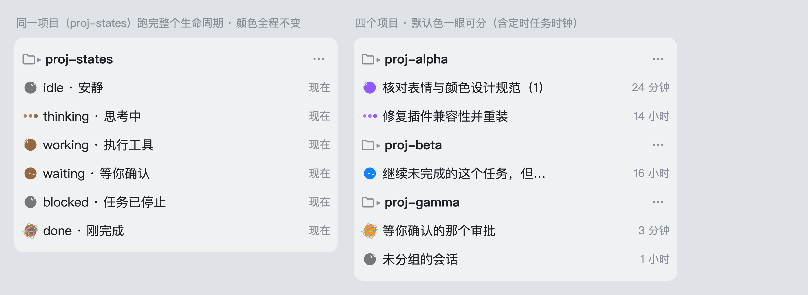
</p>
<p align="center">
  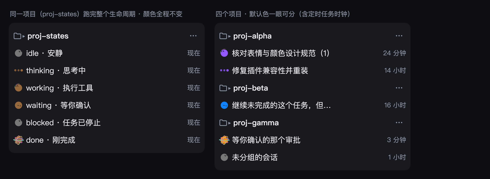
</p>

**在哪改**：项目行右侧的「⋯」菜单里，和「重命名 / 删除工作区」并列，多一项「颜色」。
点开是调色板：16 个色块（8 个官方色 + 8 个扩充色）+ 自定义 hex 输入 + 「恢复默认」。

<p align="center">
  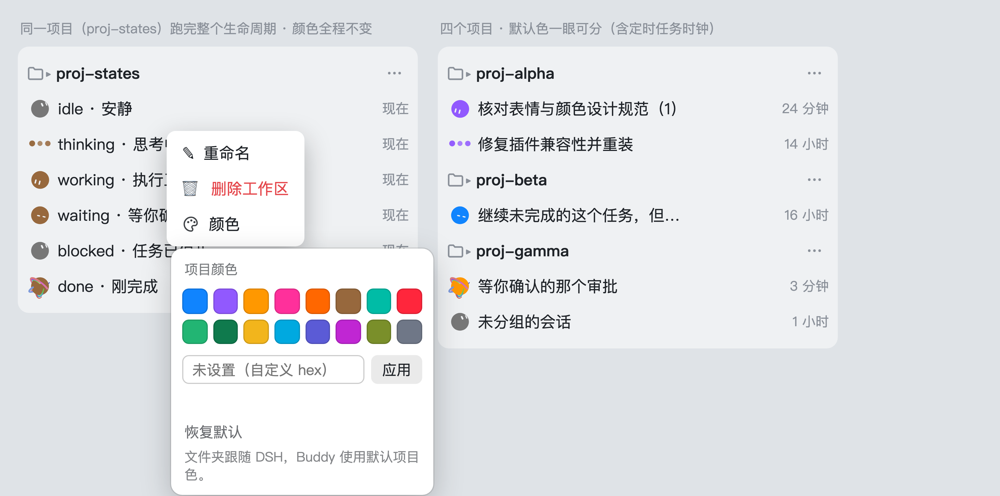
</p>

未设置颜色时调色板**不假装已选**：没有任何色块被标成当前色，自定义输入框留空并提示
「未设置（自定义 hex）」—— 只是打开调色板不会写入任何配置。设置过颜色后，对应的色块
与自定义值才显示为当前选择。「恢复默认」的说明是**「文件夹跟随 DSH，Buddy 使用默认
项目色。」**，不再把文件夹的默认颜色写成一个固定色值。

改完**立刻**生效：该项目下所有已挂载的头像**和项目行左侧的原生文件夹图标**当场换色，
不用等轮询、不用刷新。写入失败时头像与文件夹一起回滚并给出可观察提示；
连续写入与轮询不会出现「旧响应覆盖新选择」。

### 文件夹：默认就是 DSH 原生色

项目行最前面那个 DSH 原生文件夹图标（展开/收起两种造型）只在**用户为该项目显式选过
颜色**之后才跟着项目色走：

| 状态 | 文件夹 | Buddy |
| --- | --- | --- |
| 从没选过颜色 | **DSH 原生色**（普通态宿主灰、含当前会话时宿主选中色、随明暗主题） | 哈希默认项目色 |
| 选过预设色 / 自定义 hex | 所选项目色，与彩色 Buddy 主体同色 | 所选项目色 |
| 点了「恢复默认」 | 立刻回到 DSH 原生色，刷新后仍是 | 回到哈希默认项目色 |

<p align="center">
  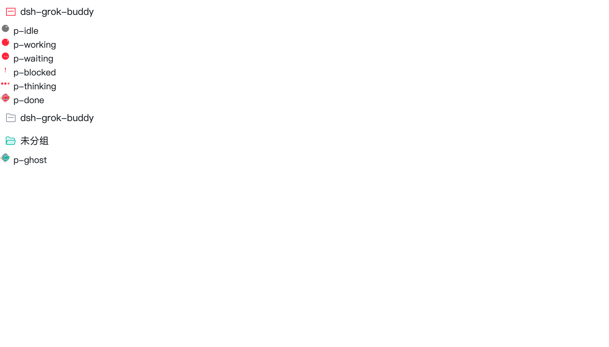
  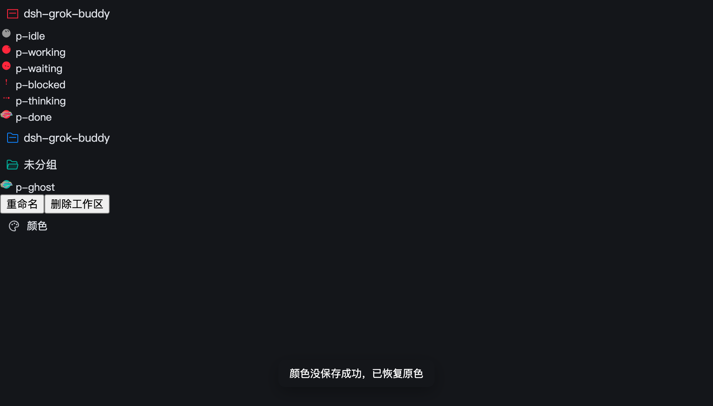
</p>

「原生色」不是一个固定色值，而是**宿主实时决定**的：普通态、含当前会话时的选中色
（`folderActive`）、明暗主题、以及宿主以后任何样式变化。恢复方式是**撤销插件的颜色
覆盖**（摘掉 `data-dsgb-workspace-folder` 与 `--dsgb-workspace-ink`），让宿主 CSS
重新生效 —— 不硬编码灰色或蓝色，不把 `computedStyle` 读一次写回，也不用
`color: inherit/initial` 冒充恢复，更不删宿主的 `folderActive` 等状态类。

有显式颜色时与 Buddy 共用同一个取色入口（`inkOfProject`：同项目、同主题、同背景、
同一套对比度规则）。判断依据是**有没有有效的显式配置**，不是颜色值是否等于哈希默认色：
用户选的色即使恰好等于 `defaultInk(workspaceId)`，也仍然算「已设置」，文件夹照常着色。
未分组项目沿用 `storeKey()` 的 `__ungrouped__` 规则。

折叠的、空的、没有活跃会话的项目同样处理（不依赖会话记录）。Buddy 的灰色规则
（空闲、失活、完成消费后）只作用于头像，不影响文件夹。图标本身仍是 DSH 的原生
SVG（尺寸、占位、viewBox、描边、开合造型全部原样），只是它的 `currentColor` 指到
项目墨色上；项目标题、箭头、菜单不会被一起染色，也不新增任何圆点或角标。

**持久化**：写在 `$DSH_HOME/dsh-grok-buddy/colors.json`（默认 `~/.dsh/dsh-grok-buddy/colors.json`），
按 workspaceId 存，顺手记一份目录路径作可读备份。

```json
{ "version": 1, "projects": { "proj-alpha": "#9159fe" },
  "paths": { "proj-alpha": "/Users/space/IdeaProjects/demo" } }
```

不用 localStorage —— 桌面端和 dsh web 的来源会变，重启就丢。写盘是「写 tmp 再 rename」
的原子写；文件损坏、字段缺失、非法颜色一律不崩，Buddy 退回哈希默认色、
文件夹退回 DSH 原生色，并打一条 warn。

### 新建文件夹自动配色与「只显示活跃会话」

**自动配色**：项目行 ⋯ 菜单 →「颜色」→ 调色板底部的「新建文件夹自动配色（全局）」。
打开后，**之后新建的** Workspace 文件夹会由宿主半侧从调色板 16 色中随机挑一个
**没有被任何项目显式使用**的颜色；16 色全被占用时退回随机 hex，并且仍然避开已用集合。
已有文件夹一律不重算、不改色，已经重复的手动配色也不会被插件修改。开关关闭后，
新建文件夹恢复 DSH 原来的行为，已自动分配的颜色保留。

- **全量来源**：新增 **GET /dsh-grok-buddy/workspaces.json**。宿主权威来源是
  `ctx.workspaceRegistry.list()`（按 `workspaceIds` 顺序返回 `WorkspaceEntity`，
  实体字段为 `id`），并兼容 `workspaces` / `workspace` / `workspaceController` /
  `workspaceService` 的 `list()` / `snapshot()` / `getSnapshot()` / `items` /
  `workspaces`。服务不存在或形状不认识时返回 501，页面显示缺失契约并
  **拒绝自动配色**；不使用 DOM 已渲染行、虚拟列表或 600ms 稳定窗口猜「新建」。
- **基线**：点击开启时**重新请求一次** `workspaces.json`，用当下的全量列表
  一次性写入 `knownWorkspaces` + `baselineComplete`；只有基线完成之后出现的
  ID 才会进入自动分配。列表 `phase` 未 ready 或 `state=loading` 时返回 503，
  绝不当空列表。
- **服务端守卫**：已有显式颜色的重复请求成功返回原色；属于 `knownWorkspaces`
  或 `autoAssignedWorkspaces`、但当前没有颜色的请求返回成功跳过，不落色；
  `baselineComplete` 未建立时直接拒绝。因此用户重置成默认色、旧请求、
  另一窗口迟到请求都不能把旧文件夹重新自动染色。
- 多个新建文件夹同时出现时，服务端在同一个同步段里「读已用集合 → 选色 → 写盘」，
  第二个请求会看到第一个的结果，因此不会撞色。
- 颜色写盘失败会回滚内存并返回错误；颜色已写入、但 known/assigned 记录写失败时
  返回可重试错误，页面重试后走「已有颜色」分支补记，不会改其它项目的颜色。
- 设置持久化在 `$DSH_HOME/dsh-grok-buddy/settings.json`（默认
  `~/.dsh/dsh-grok-buddy/settings.json`），与 colors.json 一样是原子写；
  文件损坏或字段非法时退回「关闭/未建立基线」，不阻塞页面。

**只显示活跃会话**：侧栏「工作区」标题栏搜索图标左侧新增一个活动脉冲图标按钮。
启用后只保留活跃的会话行，并隐藏没有活跃会话的分组；再次点击摘掉插件自己的
`data-dsgb-active-only` 和行标记，恢复宿主原来的列表、搜索与筛选状态。

活跃判定**复用头像已经算好的 `isActive`**（来自 [src/widget/activity.js](src/widget/activity.js)：
thinking / working / waiting / blocked、选中行、以及尚未消费的完成），不另写一套优先级。

判定来源有两条，结果同源：

- **已渲染的会话行** —— 直接读头像写的 `data-dsgb-tone`（active / dormant）。
- **折叠文件夹里的会话** —— 宿主对折叠分区**根本不渲染**子行，所以这里不看 DOM：
  读 `GET /dsh-grok-buddy/workspaces.json` 的 `members`（宿主 `workspaceRegistry`
  的 `workspace.sessionIds` 投影，是「会话属于哪个文件夹」的权威来源），再把
  `members` 里的每个会话交给 widget 的 `__dshGrokBuddy.activity(sessionIds)`。
  该接口走的是与头像**完全相同**的一条链路（`semanticOf` → `displayOf` → `isActive`），
  共用同一份完成生命周期记录，所以折叠状态下的完成、消费与失活阈值与展开时一致。
  判定结果每个节拍重算，状态一变（开始跑、进入等待、完成、被消费）分组显隐随之更新。

为了让折叠文件夹里的活跃会话**看得见**，筛选开启期间会调用宿主项目行自己的
`onToggle` 把「有活跃会话却折叠着」的文件夹临时展开，关闭筛选时再折回原来的
展开状态：插件只展开它判定必要的那几个，用户亲手点过展开/折叠的文件夹一律不接管
（展开失败时按 1.2s 退避、最多 4 次，绝不每帧硬点）。列表还没拿到 `members` 时，
对没有已渲染会话行的分组**保持可见** —— 宁可多显示，也不能因为读不到归属就把
折叠文件夹全判成空。

该开关不修改宿主的数据层筛选、搜索或归档状态，也不写入任何持久化的展开设置。

### 动作

六个状态各对一个**动作**（动作名不是状态名）。动作的具体形态与量测过程见
[docs/motion-spec.md](docs/motion-spec.md)，实现见 [src/grokbot/motion.js](src/grokbot/motion.js)。

| 状态 | 动作 | 画的是什么 |
| --- | --- | --- |
| idle | `rest` | 圆头像 + 竖眼；每 6.4 s 一次「看一眼再停住」的慢转头，4.8 s 眨眼一次 |
| working | `spin` | 官方完整球面转身；单平面渐变开放尾迹随转速生长、前后穿插、收短；完整表演每 4.6 s 循环 |
| waiting | `half-lidded` | 圆头像 + 压扁上翘的横线眼（0.175D×0.065D，+12°/+14°），低活动度呼吸 |
| blocked | `bang` | **头像退出**，主体是感叹号：上方圆头长条（顶宽 0.146D、上宽下窄）+ 下方圆点（0.121D），稳态完全静止 |
| thinking | `tri-dot` | **头像退出**，三颗横排圆点依次脉动：周期 1.4 s、相位差 1/3；点径/间距按侧栏可读性放大（0.28D / 0.44D，24px 下单点 4.5–5.4 px） |
| done | `orbit` | 官方九圈转头 + 三圈翻滚，三平面九条渐变开放尾迹；加速、减速回正并自然收尾，每 6.2 s 循环完整庆祝 |

这四条是硬要求，也是验收时要看的：

* **blocked 必须是感叹号**，不是「两个圆眼睛不眨眼」；
* **thinking 必须是三点脉动**，不是「斜眼思考脸」；
* **done 必须有立体渐变尾迹与翻滚**，不是「笑眼 + 更快的眨眼」；
* **working 必须有完整转身与重复出现的渐变开放尾迹**，不是「换脸更快」或只播一次入场。

working / done 已按官网实际渲染器重建，删除早期手调的同心彩虹弧和六个椭圆。
验证采用独立采集的官方眼型、投影、带状路径与渐变数据，再经过 Chrome 像素对比。
循环适配、随机初态与精确范围见 [动作规格](docs/motion-spec.md)；不把演示结束等同于退出 done。

**命令/工具触发与短调用**：宿主真实 `tool/call → tool/result` 事件统一覆盖 bash、命令执行及普通/MCP 工具，不按工具名称白名单筛选；有并发工具未结束时仍为 working，模型吐字不覆盖它。挂起审批/提问仍优先 waiting，明确终局优先 done/blocked/idle。

working 的播放起点向原生时间轴前移 1500ms（不改变转身速度与几何），进入约 200ms 已出现彩带。
500ms 轮询可能漏过短调用，因此快照保留最近一次真实调用的去重证据：只在当前仍是 thinking/working、同轮、证据不超过 1500ms 时补一段 650ms 动效。**这是动效提示，不把已结束的工具伪报为仍在执行**：`data-dsgb-phase` 与读屏语义不变，`data-dsgb-cue="recent-tool"` 标记提示。同次轮询不续期；等待/终局、后台或 reduced-motion 不补播。已经结束整轮的任务不为了补播旧工具而推迟完成动画。

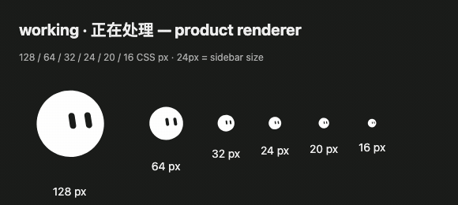
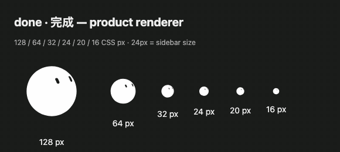

以上是产品渲染器逐帧采样，不是运行时使用的 GIF 贴图，也不代表真实 DSH 安装验收。
24px 是当前侧栏尺寸，20px 为放大前对照，16px 为兼容展示；未把静态测试全绿当作目标宿主已更新。

颜色仍然只表示项目身份：六态同色。轨道与拖尾是参考动画里明确存在的**特效层**，
保留多色；头像、感叹号、思考点的基础墨色仍是项目色（思考点的明暗是同一色的透明度）。

**prefers-reduced-motion**：**不启动持续动画** —— 不是只关掉转头和视线偏移。
眨眼、转头、轨道旋转、拖尾与 RAF 全部停掉，直接画一帧该状态的**代表性静态姿态**；
六态的区分靠姿态本身加可访问文案（aria-label 跟着状态更新，中英各一套）。
系统偏好在运行时变化时会重画静态姿态或恢复动画，**不改变任何业务状态**：
done 在 reduced-motion 下仍是 done。

静态姿态也保留六态的可识别性，不会全退回普通圆脸：
blocked 还是感叹号、thinking 还是三颗点、done 还是头像 + 轨道、working 还是带头像与拖尾。

### 动态预览与真浏览器核对

[preview.html](preview.html) 用**产品同一个渲染器**做对照台，不是另写一套演示动画：

* 六态单切 / 并排；64 / 32 / 16 px 三档真实尺寸；
* 项目色与白色参考模式；深色与浅色背景；
* 播放、暂停、16ms/100ms 步进、0.25× 与 1× 速度；
* 任意两态互切（idle→thinking、thinking→working、working→done、done→thinking …），
  不只是 GIF 里的固定顺序；
* 同态反复送快照但不重播、reduced-motion 开关、done 长时间持续、深浅背景切换。

参考录屏的对应帧放在 [docs/reference-*.png](docs/reference-idle.png)，与实现并排对照
（已裁掉播放按钮、六态标签、进度条和鼠标 —— 它们不是头像的一部分）。

```bash
node scripts/browser-check.mjs    # 真 Chrome 里核对预览页的图层/几何/帧推进
node scripts/bundle-check.mjs     # 真 Chrome 里跑**构建产物** lib/widget.js
```

`browser-check.mjs` 起一个真的 Chrome（headless、零依赖 CDP），在真实 SVG 上核对图层构成、
24px 布局矩形、轨道是否被裁、帧是否真的在推进、同态快照是否误重启动画、reduced-motion
是否真的不跑帧，并输出截图。

`bundle-check.mjs` 更进一步：它在真浏览器里加载**构建产物** `lib/widget.js`
（不是预览页的同源模块），对着复刻的侧栏 DOM 跑一次 boot → fetch → 挂载 → 六态渲染，
核对六态的图层构成、未知会话的兜底完成、真实尺寸布局、真实帧推进与可访问文本。
假快照由脚本自己的服务器提供，**不写真实 state.json**。

```bash
node scripts/doc-shots.mjs                       # docs/states.png、states-64/20.png、faces.png
node scripts/doc-size-compare.mjs                # docs/size-compare.png（20px vs 24px）
node scripts/doc-motion-gif.mjs                  # docs/effect.gif（逐帧抓真动画）
node scripts/doc-shot.mjs <页> <图> [选择器]       # 通用：重截任意 docs 页
node scripts/doc-shot.mjs docs/hero.html docs/hero.png --width=980 --height=620
node scripts/doc-shot.mjs 'docs/project-colors.html?palette=1' docs/project-palette-light.png \
  --width=900 --height=640 --post=1800 --include=.dsgb-palette
```

所有 README 配图都能在仓库里**重跑出来**，截的是产品同一个渲染器，不是另画的示意图。
`docs/project-colors.html` 是一个**截图台**：它伪造宿主那两份 JSON（state.json / colors.json），
其余全走真实的 `lib/widget.js`，所以图里的头像、文件夹着色、调色板都是产品代码画的。

## 界面适配：不是只有侧栏那一种行

DSH 的会话在不同表面的 DOM **结构不同**，不能假设都是 `[data-row-key^="session:"]`：

| 表面 | 结构 | 身份来源 | 本插件 |
| --- | --- | --- | --- |
| 侧栏会话行 | `div[data-row-key="session:<id>"][role=treeitem]` | `data-row-key` | **支持**（含 HoverCard 包装、嵌套 groupSection、虚拟列表复用） |
| 搜索结果行 | `div[role=treeitem]`，**无 data-row-key** | 只有标题文本 | **不猜身份**，记 `unidentifiableSearch` |
| 悬停卡片 | HoverCard 用 `createPortal` 挂到 body；正文由 `renderSlot("sidebar.session.row.hover", { sessionId })` 渲染 | sessionId 是 **React 参数**，不进 DOM | **不挂头像**（卡片自身已显示标题与状态行） |

搜索行的 16px 槽位是嵌套结构（`searchResultHeading > slot`），**不是**「首个窄于
20px 的子节点」。缺稳定身份时宁可不上头像，也不按标题或顺序猜 —— 那会张冠李戴到
同名会话上，比不显示更糟。

要覆盖这两种表面，需要一个**公开的稳定身份入口**，二选一：

1. 在搜索结果行上暴露 `data-row-key="session:<id>"`（最小改动，本插件已能自动识别，
   见 [test/surface-adapters.test.mjs](test/surface-adapters.test.mjs) 的 S8）；或
2. 提供 `sidebar.workspaces.search.result.leading` 之类的 leading 槽位。

这两条都需要宿主改动，或用 `dsh.client` 模块 + `ctx.slots` 注册（本插件当前走
head 注入，不是 client 模块）。本插件不修改安装包、不依赖 React Fiber 等私有结构
绕过这一条。

同一 session 在多个表面同时显示时，**共享事实与完成消费**，但各自拥有独立的 DOM
动画实例。

## 安装

```bash
dsh plugin --profile <PROFILE> add github:devzer0o0/dsh-grok-buddy
```

装完确认三件事：

1. `node_modules/dsh-grok-buddy` 里有 `lib/index.js` 和 `lib/widget.js`；
   缺了就在插件目录跑一次 `npm run build`（或 `node scripts/build.mjs`），再重新装。
2. profile 的 `package.json` 里 `dsh.profile.bundles` 包含 `dsh-grok-buddy`。
3. **重启宿主**（见下一节 —— 只刷新页面不会加载宿主侧改动）。

插件清单在 [cordis.patch.yml](cordis.patch.yml)（`package.json` 的 `dsh.bundle.patch` 指向它）。

## 刷新、重启与验收（三件事不一样）

| 动作 | 生效范围 | 说明 |
| --- | --- | --- |
| **重新加载 renderer 页面** | 只换**页面脚本** | `lib/widget.js` 是每次请求现读磁盘的，页面脚本改完刷新就生效；**不**加载宿主侧改动 |
| **重启宿主** | 宿主侧 `lib/index.js`、`lib/derive.js`、`lib/fold.js`、`lib/probe.js`、路由 | 事件处理、状态折叠、HTTP 路由的改动**必须**重启宿主才生效 |
| **重新安装插件文件** | 磁盘上的包 | profile 里的 `node_modules` 是拷贝不是软链；改源码要重新装或手动同步，**再**重启宿主 |

**判据（不要只看版本字符串）**：

1. `curl -s <host>/dsh-grok-buddy/widget.js | md5` 与工作区 `lib/widget.js` 一致 → 页面脚本层已更新
2. `curl -s <host>/dsh-grok-buddy/state.json` 里每行**有 `reason` 与 `completionKey` 字段** → 宿主层已加载新版
3. 页面里 `__dshGrokBuddy.version` 与构建标识一致 → 页内实例是新的

第 2 条不过，说明宿主还没重启 —— 此时页面即使刷了小版本也拿不到新语义。

## 诊断（默认关闭）

不复默认无限期后台采样。诊断是一个**一次性窗口**：

```bash
# 1) 打开一个采样窗口（最长 60 秒）
curl -s -X POST -H 'Content-Type: application/json' \
  -d '{"action":"arm","ms":10000}' \
  http://127.0.0.1:<port>/dsh-grok-buddy/probe-control.json

# 2) 页面上触发采样：window.__dshGrokBuddy.armProbe(5000)

# 3) 取回样本
curl -s http://127.0.0.1:<port>/dsh-grok-buddy/probe.json

# 4) 关掉
curl -s -X POST -H 'Content-Type: application/json' \
  -d '{"action":"disarm"}' \
  http://127.0.0.1:<port>/dsh-grok-buddy/probe-control.json
```

样本里有：build、pageId、采样时间与接收时间、是否过期（stale / ageMs）、
每行的身份、原始相位、判定理由、最终状态、完成消费状态、槽位矩形、
display / visibility / opacity、动画是否在跑、aria-label。

**不会**上传会话标题、正文、工具参数、路径或凭据（服务端还有一层白名单兜底）。
GET 返回 200 但 `probe` 为 null **不算**链路通 —— 那表示没开窗口或没有样本。

## 工作原理

宿主半侧（[lib/index.js](lib/index.js)）：

* 订阅 `session/event`：turn/step 边界、tool/call、tool/result、approval/asked、
  llm/retry、turn/end、标题与工作目录
* 订阅 `agent/assistant-stream`：只看有没有开始吐字
* 订阅 `agent/status` 与 `agent/error`：agent 是否在跑、有没有崩
* 读 `sessionProjections` 的 userQuestions：挂起的提问与计划评审
* [lib/fold.js](lib/fold.js) 把这些折成**事实**（不产出状态名）
* [src/decision.js](src/decision.js) 用事实 + 展示输入算出**六态**（唯一决策表）
* 暴露 `GET /dsh-grok-buddy/state.json`，并在页面 head 注入 `/dsh-grok-buddy/widget.js`
* 暴露 `GET/POST /dsh-grok-buddy/colors.json`、`probe.json`、`probe-control.json`

注入走两条路：`webserver/index-inject` 结构化注入行（桌面版唯一受支持的方式），
外加 `webServer.tapIndex` 兜底（Host 自己渲染 index.html 时）。

### 「任务级错误停止」的真实来源

全部取自宿主真实契约，没有自造事件名：

| 来源 | 真实事实 | 为什么可信 |
| --- | --- | --- |
| `turn/end` reason.error | `TurnEndReasonMap.error = { kind:'error'; error: LlmFailure }` | 执行器把这一轮**记录为**错误终态：会话日志里它就是这一轮的结局 |
| `agent/error` + `agent/status=idle` | 执行器停稳，这一轮**还开着**且**没留下任何 `turn/end`** | 覆盖「启动阶段致命失败」：真实链条是 turn/start → throwError(agent/error) → finally 里 turn/end 写入失败 → 走到这里 |

两项都要求执行身份非空且与当前轮**严格相等**：`turn/end` 必须带 `turn`；`agent/error`
必须带 `turn`（宿主 `throwError` 的载荷总是 `{ turn, step, error }`）。缺 turn 的错误只能
是别的插件/观察链路的诊断，绑定不到当前任务，也不能等 idle 把它升级成本轮的 blocked。

⚠️ **已知因果限制**：宿主的 `turn()` 在 `finally` 里写 `turn/end`，该 append 失败时同样会
调用 `throwError`。所以「agent/error + idle 且没有 `turn/end`」既可能是错误执行失败，
也可能是**完成 / 取消 / 拒绝**之后仅终局日志写入失败。插件侧只有这些信号时无法区分；
在宿主暴露原始停止原因之前，这条兜底路径不能被当成「已覆盖全部致命失败」。

明确**不算**错误停止的两种终局：

- `turn/end` reason.blocked 是 **preStep 决策拒绝**（`decision.kind === 'reject'`），宿主
  不附 error —— 这一轮没有继续，但停的原因不是错误，显示 idle；
- `aborted`（user / parent / hook / disposed / legacy）是**取消**。即使之前收到过
  `agent/error`，也不猜测因果 —— 取消终局权威，显示 idle。

**单独一条 `agent/error` 不算停止**：其它插件也用这个事件汇报非致命问题（例如持久化
flush 失败），所以它只写「暂定停止」，等上面的生命周期事实确认后才升级成 blocked。

`llm/retry` / `llm/retry-started` 不是停止证据：它们证明**自动恢复仍在进行**，任务保持
thinking。

页面不再「看见 blocked 就画出感叹号」：快照里带 `stopCertain / stopCause / stopSource /
stopCode / stopTurnKey`。校验只有一处实现（[src/decision.js](src/decision.js) 的
`stopProofOf()`，宿主与页面共用）：确证来源、明确 `cause=error`、身份非空且等于当前轮、
且不被成功/非错误终态取代 —— 缺任何一条都降级为 idle 并保留诊断原因。

**封账规则**：任何终局（成功 / 错误 / 取消 / 拒绝）落定后，这一轮不再接受任何同轮事件
（迟到终局、错误、流分片、工具调用都不行），唯一出口是下一轮 `turn/start`。停止事实也
不会随普通缓存 TTL 被回收 —— 它只能被真实恢复、新任务或权威会话删除替代。

页面半侧（[src/widget/](src/widget/) → 构建成 `lib/widget.js`）：

* 轮询 state.json，在侧栏会话行的前导位里放一只头像（`BOT_SIZE`，现为 24px）
* 状态位改成**按内容撑开**（只剩头像时就是 24px 宽）：DSH 会往同一格再塞自己的标记
  （例如定时任务的时钟，16px），定宽格子必然溢出、时钟压到标题上
* 头像实例按 DOM 槽位索引；同一槽位被复用于另一个会话时**重新绑定身份**
* 节点离开 DOM 后动画会停，挂回来时重新起循环（不是留守静止 SVG）
* 眼睛的底色**从状态位背后量**，主题一变就重刷
* 项目归属：向上找最近的 `.groupSection` 再取项目行 key

> ⚠️ **不能用 `:scope >` 直接取项目行**。DSH 的 HoverCard 把每一行都包进一层
> `span.hc-root`，项目行不是分区的直接子节点 —— `:scope >` 会返回 0 个，所有会话都会
> 掉进「未分组」。现在的做法是在分区内找项目行，再用「最近的 `.groupSection` 是不是
> 我自己」排除嵌套分区里的那些。

* 改色入口：项目行「⋯」菜单是 DSH 前端硬编码的，没有开放 slot，所以在菜单容器
  `[data-menu-material]` 里补一项「颜色」。容器会复用，所以归属在**点击那一刻**重新算
* 项目行**不放**任何额外装饰：文件夹前面只留 DSH 自己的图标。文件夹图标只在
  项目**显式设过颜色**时按项目身份色着色（复用 currentColor + 插件 CSS 变量，
  只改 color，不改布局）；没设过时保持宿主原生色，插件不碰这一格

**只读观测**：不写会话、不改模型请求。卸载后把节点、监听、定时器、样式、
全局对象全部清掉，并恢复宿主自己的属性。

## 开发

```bash
node scripts/build.mjs            # src/ → lib/widget.js（单文件 IIFE）
node --test "test/*.test.mjs"     # 单元 / 决策 / 路由 / 构建产物集成测试
```

`lib/widget.js` 是**入库的构建产物**。改了 `src/` 却没重新构建，CI 会红
（[.github/workflows/npm-publish.yml](.github/workflows/npm-publish.yml) 里有一条
`git diff --exit-code -- lib/widget.js`）。

测试分三层：

* [test/decision.test.mjs](test/decision.test.mjs)、[test/derive.test.mjs](test/derive.test.mjs)：六态判定与事件身份
* [test/probe-route.test.mjs](test/probe-route.test.mjs)、[test/colors-route.test.mjs](test/colors-route.test.mjs)：真实 HTTP 路由
* [test/widget-integration.test.mjs](test/widget-integration.test.mjs)：**把构建产物真的跑起来**
  （boot / fetch / sync / mount / 动画 / observer / dispose），不是复制一份实现重测

`preview.html` 与 `docs/*.html` 跑的都是构建产物本身，不依赖 DSH。

## 未完成与已知边界

**功能缺口（需宿主改动，本插件不猜）**

* **搜索结果行**：当前 DSH 的 `SearchResultItem` 只渲染 `role/aria-selected`，
  不写 `data-row-key`；16px 槽位嵌在 `searchResultHeading > slot` 里。
  本插件如实记账（`unidentifiableSearch`）但不挂头像。
* **悬停卡片**：`HoverCard` 用 `createPortal` 挂到 `document.body`，
  `sessionId` 只是 `renderSlot("sidebar.session.row.hover", { sessionId })` 的
  React 参数，不进 DOM。不挂独立头像（卡片自身已显示标题与状态行）。
* 上述两条都可用 `dsh.client` 模块 + `ctx.slots` 注册解决，但本插件当前走
  head 注入架构，不是 client 模块。

**证据边界（不要过度解读）**

* HTTP `/dsh-grok-buddy/widget.js` 返回的 hash 一致，只证明**服务端在提供新 bundle**；
  它**不**证明宿主进程加载了新逻辑，也**不**证明当前 renderer 实例执行了新 bundle。
  三层要分别核验（见「刷新、重启与验收」）。
* 兜底完成周期的 `generation` 是页面内存计数，**跨重启严格去重不成立**。
* `prefers-reduced-motion` 的静态姿态只保证六态在素材层可区分；
  侧栏里（24px）的可辨识度以真实截评为准，不以放大预览为准。

## 致谢与许可

BSD-3-Clause。头像几何、表情与体形数据来自
[nasawz/GrokBot](https://github.com/nasawz/GrokBot)（BSD-3-Clause），
经 [dsh-thought-buddy](https://github.com/dsh-plugins/dsh-thought-buddy) 的移植版转写。
详见 [LICENSE](LICENSE)。

本项目与 xAI 无隶属关系，只是用了 Grok Bot 这个公开形象。
