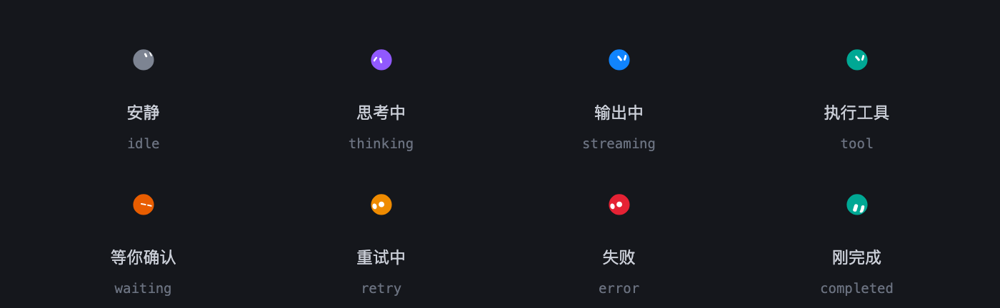

<div align="center">


# dsh-grok-buddy

**把 Grok Bot 本人那张脸，装进 DeepSeek Harness 的会话列表。**

每个会话（任务）在侧栏的那一行，原来的彩色小圆点换成一只会呼吸的 GrokBot 头像：
它在思考、在输出、在跑工具、在等你点确认、失败了、还是刚干完 —— **看脸就知道**。


[](https://github.com/topics/dsh-plugin)
[](https://www.npmjs.com/package/dsh-grok-buddy)
[](./LICENSE)

</div>

## 这是什么

一句话：**DSH 侧栏里每个会话的状态，由 Grok Bot 那张脸来演。**

它没有另画一套图标，也不是随便找个 emoji 顶上去 —— 用的是 Grok Bot 自己的头像和表情：
一颗圆滚滚的 blob，两只眼睛贴在球面上，转头时会跟着透视变形、转到背面会消失；
表情切换是带弹簧的形变，平时还会随机眨眼。

<p align="center"></p>

## 为什么是这张脸

Grok Bot 的设计文章把这件事讲得很清楚：他们要解决的不是「怎么再塞一个进度指示器」，
而是「怎么让头像本身承担状态」。

> We could have represented each state with a separate indicator, but that would
> have added another layer of UI for the user to interpret. Instead, we explored
> how much of the lifecycle the avatar itself could carry.

所以这里也照做：**不新增任何 UI 元素**，只把侧栏原本那个彩色小圆点换成一个会呼吸的头像。
位置、尺寸（18px）、行高全都不变 —— 它就在原来那个位置，只是开始有表情了。

## 状态映射

官方生命周期是 Idle / Working / Waiting / Blocked / Thinking / Done。DSH 的事件更细，
映射关系如下（左：DSH 相位，右：GrokBot 状态）：

| DSH 相位 | 触发条件 | GrokBot 状态 | 外观 |
| --- | --- | --- | --- |
| `idle` | 没有活动 | `idle` | 灰蓝，平静地眨眼 |
| `thinking` | 已发请求、等首 token | `thinking` | 紫色，眼珠来回游移 |
| `streaming` | 模型正在吐字 | `working` | 蓝色，专注 |
| `tool` | 工具执行中 | `working` | 青绿，专注 |
| `waiting` | 审批挂起，轮到你 | `bored` | 橙色，有点百无聊赖地等你 |
| `retry` | 请求失败、正在退避重试 | `curious` | 琥珀，歪头看你 |
| `error` | 本轮以错误收场 | `alerting` | 红色，警觉 |
| `completed` | 刚做完、还没被看过 | `celebrate` | 青绿，开心 |

鼠标悬停能看到具体细节（在读哪个工具、失败代号、重试次数）。

## 安装

复制下面这段，直接贴给 DSH 里的助手，它会替你装好并验证：

```text
安装 dsh-grok-buddy 插件到我的 DSH profile（没说的话先问我用哪个 profile）。
npm 包名是 `dsh-grok-buddy`。

步骤：
1. 加依赖：`dsh plugin --profile <PROFILE> add dsh-grok-buddy`
2. 确认 node_modules/dsh-grok-buddy 里有构建产物 lib/index.js 和 lib/widget.js；
   缺了就在插件目录跑一次 `npm run build` 再重新加。
3. 确认 profile 的 package.json 里 dsh.profile.bundles 包含 `dsh-grok-buddy` ——
   本包自带 cordis.patch.yml，只要在 bundles 列表里，启动时那一行会自动插进配置树。
4. 不要启动 profile，装完验证即可，然后告诉我你改了什么。
```

然后重启 `dsh web`（或让 HMR 生效）并刷新页面。

也可以从 [dsh-market](https://dshmarket.com) 插件市场里搜索 `dsh-grok-buddy` 一键安装 ——
本包发布在 npm，市场会从 npm registry 直接索引到它。

想从源码装：

```bash
cd ~/.dsh/profiles/<PROFILE>
pnpm add github:devzer0o0/dsh-grok-buddy
```

## 工作原理

宿主半侧（`lib/index.js`）：

* 订阅 `session/event`：turn/step 边界、`tool/call`、`tool/result`、`approval/asked`、
  `llm/retry`、`turn/end`、标题与工作目录
* 订阅 `agent/assistant-stream`：只看有没有开始吐字
* 订阅 `agent/status` 与 `agent/error`：agent 是否在跑、有没有崩
* 把这些折叠成每个会话一个相位（`lib/derive.js`，纯函数，可单测）
* 暴露 `GET /dsh-grok-buddy/state.json`，并在页面 head 注入 `/dsh-grok-buddy/widget.js`

注入走两条路：`webserver/index-inject` 结构化注入行（桌面版唯一受支持的方式），
外加 `webServer.tapIndex` 兜底（Host 自己渲染 index.html 时）。

页面半侧（`src/widget/` → 构建成 `lib/widget.js`）：

* 轮询 state.json，在每一行 `[data-row-key^="session:"]` 的 18px 状态位里放一只头像
* 隐藏框架自带的圆点和转圈（只针对状态位内部，不碰其它插件的座位）
* 头像实例按 DOM 槽位索引，同一会话同时出现在列表和搜索里也不会互相抢节点

**只读观测**：不写会话、不改模型请求、不注册投影。卸载后把挂上去的节点全部摘掉。

无需任何构建依赖，Node 22+ 即可；`lib/widget.js` 是构建产物，仓库里已带。

## 开发

```bash
node scripts/build.mjs            # src/ → lib/widget.js（单文件 IIFE）
node --test "test/*.test.mjs"     # 11 个相位推导单测
```

打开 `preview.html`（需要起个静态服务，因为用了 ES module）可以看八种状态的实时效果，
它跑的是构建产物本身，不依赖 DSH。

## 致谢与许可

BSD-3-Clause。头像几何、表情与体形数据来自
[nasawz/GrokBot](https://github.com/nasawz/GrokBot)（BSD-3-Clause），
经 [dsh-thought-buddy](https://github.com/dsh-plugins/dsh-thought-buddy) 的移植版转写。
详见 [LICENSE](LICENSE)。

本项目与 xAI 无隶属关系，只是用了 Grok Bot 这个公开形象。
