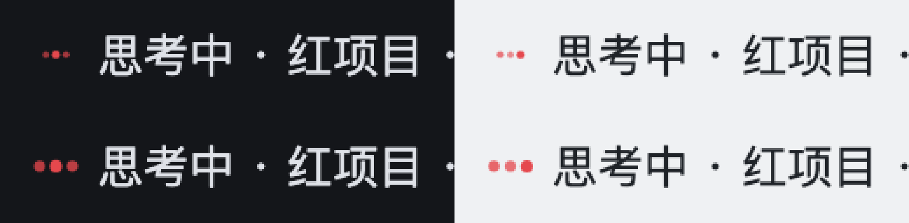
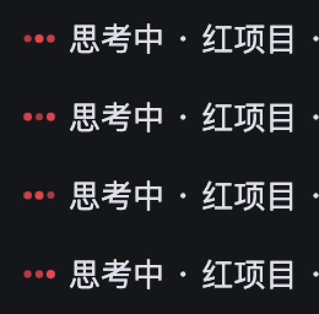

# 六态动作规格（逐帧量测）

这份文档记录**每个动作长什么样、为什么是这个数**。实现是
[`src/grokbot/motion.js`](../src/grokbot/motion.js)，渲染是
[`src/grokbot/engine.js`](../src/grokbot/engine.js)。

## 参考材料的来源与指纹

| 项 | 值 |
|---|---|
| 文件 | 用户提供的录屏 `reference-six-states.gif` |
| 画布 | 800 × 396 |
| 帧数 | 1397 |
| 总时长 | 28.26 s（逐帧 duration 累加，不是「帧号 ÷ 标称帧率」） |
| SHA-256 | `57a214b7730558fed8435ac8d14a684e528d5c61535cf232cdb1635c0a4eeb2a` |
| 本地保存 | 仓库外 `~/.dsh-grok-buddy-ref/reference-six-states.gif`（不随 npm 包发布） |
| 文档用截图 | [`docs/reference-*.png`](./reference-idle.png)，从录屏裁出，已去掉播放按钮/标签/进度条/鼠标 |

补充参考：[x.ai — Designing Grok Bot](https://x.ai/news/designing-grok-bot) 的 Avatar motion system。

### 量测口径

- **归一化基准**：录屏里头像身体直径 `REF_D_PX = 103` px。所有长度除以它，
  得到「相对 D 的比例」，再乘回身体坐标系（`BOT_D = 210`）。
  800×396 的录屏画布**不**当作头像坐标。
- **时间**：用 `ffprobe -show_entries frame=pts_time,duration_time` 逐帧累加，
  不用标称帧率推算。第 0 帧 `duration` 是 40ms，其余 20ms。
- **分段边界**：以录屏里高亮标签的切换为定位，再用实际帧确认过渡起点。
  这些时间**只用于定位录屏内容**，不是业务状态时长，也不是动画循环周期。

| 状态 | 录屏时间段 | 帧号 |
|---|---|---|
| idle | 0.00 – 5.0 s | 0 – 246 |
| working | 5.0 – 9.5 s | 246 – 470 |
| waiting | 9.5 – 13.8 s | 470 – 682 |
| blocked | 13.8 – 18.0 s | 682 – 888 |
| thinking | 18.0 – 22.7 s | 888 – 1121 |
| done | 22.7 – 26.9 s | 1121 – 1330 |
| 回到 idle | 26.9 s 之后 | 1330 – 1396 |

---

## idle → `rest`

**已测量**（帧 0–246）

- 主体：圆形头像，直径恒为 103px；眼睛是两只竖椭圆，眼对中点落在
  `(+0.09D, -0.23D)` 附近（角 -50°），半径约 0.30D。
- 帧 0–145 停在右侧不动；帧 150–200 用约 1 s 转到左侧（角 -179°，半径 0.15D），
  之后保持到该段结束。
- 眨眼：帧 0–10、帧 240 附近各有一次，间隔约 4.8 s，每次约 0.3 s。
- 眼睛尺寸：约 17×22 px = `0.165D × 0.214D`（左眼略宽 20px）。

**实现**

- `lookCycleMs = 6400`：47% 停在右侧 → 16% 慢转到左 → 27% 保持 → 10% 转回。
- `turnRight = 0.10`、`turnLeft = -0.58` 弧度。
- `blinkPeriodMs = 4800`、`blinkOffsetMs = 200`、`blinkMs = 320`。
- 微幅呼吸 `breathTurn = 0.035`（**估计**：参考里姿态几乎不动，只留可感知的活气）。

**断言**：`A1`、`A8`、`B9`。

---

## working → `spin`

**已测量**（帧 246–470）

- 主体仍在，眼睛转动明显：眼对中点水平位移 -26 px .. +15 px。
- 帧 246–258 有一次快速甩头，眼睛压到侧面（几乎消失）再回来。
- 彩色拖尾只在 **帧 310–373（1.26 s）** 出现，不是常驻：
  - 帧 312 刚出现（43 个彩色像素），帧 336 最盛（960 px），
  - 帧 372 只剩零星（15 px），帧 374 完全消失。
- 拖尾半径：`319..446 px` → 约 `0.66D`；弧长最大约 150°。
- 拖尾是**并排的彩色带**：同一帧里能数出 5 种颜色
  （`#7ad8a8` `#7ad87a` `#8a7ad8` `#d87ac0` `#d8b878`）。
- 稳态（帧 374–470）只有头像在转，**没有**拖尾。

**实现**

- 进入甩头：`whipAmp = -1.85` rad，`whipMs = 760`，只播一次。
- 稳态张望：`spinMs = 2600`、`swayAmp = 0.66`、`swayBias = -0.14`。
- 拖尾：`trailFromMs = 300`、增长 420ms、保持 380ms、淡出 420ms，
  `trailArc = 1.9`、`trailRadius = 0.66D`、整条厚度 `0.075D`（5 条色带各 `0.03D`）。

**断言**：`B1`（出现 → 缩短 → 淡出 → 消失）、`B2`、`B2b`、`E4`。

---

## waiting → `half-lidded`

**已测量**（帧 470–682）

- 主体仍是圆头像，眼睛压成横线：约 18×6.7 px = `0.175D × 0.065D`，长宽比约 2.7。
- 两只横线眼都轻微上翘：左眼 **+12°**、右眼 **+14°**。
- 眼位：左 `(-0.071D, +0.026D)`、右 `(+0.235D, +0.087D)`。
- 帧 540–660 之间眼位只漂移约 1.5 px（0.015D）——低活动度，但没有死住。

**实现**

- 眼环用**同一条**球面投影路径的胶囊多边形（不是另画一条线）。
- 呼吸 `breathMs = 4200`、`breathTurn = 0.05`（周期是**估计**，幅度是量测）。
- 半闭眼也会偶尔轻微合一下（`blink` 压到 0.25 幅度），不破坏可识别性。

**断言**：`A7`（主轴长宽比与倾角）、`E3`。

---

## blocked → `bang`

**已测量**（帧 682–888）

- 帧 676–700（0.48 s）：头像**收缩并淡出**，同时感叹号长出来 —— 不是给脸上贴一个字符。
- 稳态几何（帧 700–880 逐帧完全一致，**不做任何抖动**）：
  - 长条：y 从 `-0.325D` 到 `+0.092D`；顶宽 `0.146D`，底宽约 `0.078D`（上宽下窄），两端圆头。
  - 圆点：直径 `0.121D`，中心 `+0.253D`，与长条间距约 `0.16D`。
  - 整体居中，中心与头像中心一致（`388.5, 157.5`）。

**实现**

- 用可控的 SVG 路径画（顶圆头 + 锥形收束 + 底圆头），**不依赖字体字符 `!`**。
- 进入 `enterMs = 480`：`body.sx → 0.07`、`body.sy → 0.28`、`alpha → 0`；感叹号按缓出长大。

**断言**：`A2`（头像与眼睛都退出）、`B5`（形变而非贴字符）、`B6`（稳态不抖）。

> ⚠️ 本节只描述**动作设计**。什么时候进入 blocked 属于业务判定，动画的形态、时序
> 与稳态都不因判定规则变化而改动。

### blocked 的进入条件（业务层，与动作无关）

blocked 不是「有错误」，而是**当前任务已被确认因错误停止**：

- ✅ 宿主用 `turn/end` 的 reason=error / blocked 终结了这一轮；
- ✅ 先报 `agent/error`、随后以系统原因（parent / hook / legacy）中断，或执行器停稳到 idle；
- ❌ 单个工具失败、编译/测试失败、子任务失败而主任务继续；
- ❌ 自动重试仍在退避或正在重试（那属于 thinking）；
- ❌ 用户主动取消、原因不明的中断、静默、观察链路（state.json）出错。

判定只有一处实现（`src/decision.js` 的 `decide()`）；页面不再按相位名二次推断。

---

## thinking → `tri-dot`

**已测量**（帧 888–1121）

- 帧 884–900（0.32 s）：感叹号**摊成三颗点**，中间那颗最先出现。
- 稳态：三颗横排点，直径 `0.165D`，间距 `0.272D`，中心线 `-0.034D`。
- 脉动周期：三颗点的亮度峰值出现在帧 951 / 975 / 998，之后 1022 / 1044 / 1068 ——
  **间隔 69–71 帧 ≈ 1.40 s**，相邻两点相差 **24 帧 ≈ 0.47 s ≈ 1/3 周期**。
- 亮度 141 → 255（同一基础色的透明度变化），直径 17 → 22.5 px。
- 位置：脉动时上下漂移 ±1.5 px（±0.015D）。

**实现**

- 点径、间距、中心线、周期、相位差、透明度区间在**参考画布**里都来自上表。
- 头像与眼睛在符号态**整体退出**（`body.visible = false`），不是画在圆脸里。

**断言**：`A3`（点数恒为 3、无头像）、`B3`（相位差 1/3）、`B4`（周期稳定、点径随亮度）。

### 小尺寸可读性调整（不是量测）

参考量测是按 800×396 录屏里的 103px 头像归一得到的。搬到 DSH 侧栏的
**16px 槽位**后，量测参数对应的实际尺寸是：

| 项 | 参考量测参数 | 16px 下实际 |
|---|---|---|
| 单点直径 | `0.165D`，脉动 `×1.0–1.32` | 1.76 – 2.32 CSS px |
| 三点整体宽 | 间距 `0.272D` | 7.7 – 8.0 CSS px |
| 相邻边缘缝 | — | ≈ 0.9 CSS px（几乎粘成一条） |

也就是说「参考里对，侧栏里看不清」。下面这组数是**针对侧栏小尺寸的视觉调整**，
不是录屏量测结果，量测值原样保留在上表与本文档的历史记录里：

| 参数 | 量测值 | 侧栏调整值 | 理由 |
|---|---|---|---|
| `diamond`（点径） | 0.165 | **0.28** | 单点 2.99 – 3.58 CSS px，才看得出是三颗圆点 |
| `gap`（中心距） | 0.272 | **0.44** | 三点整体 12.4 – 12.8 px，仍完整落在 16px 图标内 |
| `alphaMin` | 0.55 | **0.72** | 小尺寸下细点的低透明度会直接糊掉，脉动节奏看不出来 |
| `scaleMax` | 1.32 | **1.20** | 点变大后峰值再放大会顶到相邻点，收一点更稳 |
| `scaleMin` / `alphaMax` | 0.55 / 1 | 1 / 1 | 不变 |
| `periodMs` / `stagger` | 1400 / 1/3 | 不变 | 节奏是这版动画的特征，不因为放大而改 |
| `lineY` / `drift` / `enterMs` | -0.034 / 0.015 / 320 | 不变 | 图标仍在原位，标题和行高不动 |

调整后在 16px 下的实测量（`test/motion.test.mjs` 的 `F1`–`F3` 逐帧断言）：

| 项 | 实测 |
|---|---|
| 稳态单点直径 | 2.99 – 3.58 CSS px（≥2.9 是验收门槛） |
| 三点整体宽度 | 12.82 CSS px（≤13 才不挤爆 16px 图标） |
| 相邻圆点边缘缝 | 最小 1.26 CSS px（不粘连） |
| 透明度下限 | 0.72（稳态最暗的点仍清楚） |
| reduced-motion 静态姿态 | 点径 2.99 / 3.58 / 2.99 px，整体 12.37 px |

两层透明度也一起理清了：**进入的淡入只由组透明度 `dots.alpha` 负责**，点自身的
`alpha` 就是脉动亮度。之前 `alpha` 还乘了一次进入进度（组透明度又乘一次），进入途中
实际可见度是「进度² × 脉动亮度」：进入中点 0.54 倍、四分之一处 0.26 倍；现在分别是
0.67 倍与 0.45 倍，稳态仍是 1。过渡帧过去也把点透明度再乘一次组透明度，中点可见度
只有 0.18 倍，现在翻倍到 0.37 倍 —— 进入、退出都没有被取消，只是不再压两次。

**断言**：`C5`（与其余五态互切不越界、不残留、进入不被压暗）、`F1`（整周期几何）、
`F2`（连续、峰值错开、点径与亮度同源）、`F3`（reduced-motion 静态姿态沿用新几何）。

**修改前后对比**（真浏览器、真 16px 图标、DPR 2，同一行同一时刻；左侧深色主题：
上=修改前、下=修改后；右侧浅色主题同序）：

脉动节奏（同一行连续四帧，间隔约 0.35 s，可看出三颗点的峰值依次错开）：

完整脉动过程见 [`thinking-dots-pulse.gif`](./thinking-dots-pulse.gif)（12 fps，侧栏真实尺寸，
按最近邻放大 3 倍便于观看）。截图由一次性夹具 `scripts/browser-check.mjs` 同款的
CDP 采样生成，行高、图标位、标题起点在修改前后逐像素一致（32 px / 16 px / 40 px）。

---

## done → `orbit`

**已测量**（帧 1121–1330）

- 帧 1116–1152（0.72 s）：三颗点收拢，头像**长回来**；轨道随后展开。
- 轨道是**多条不同倾角的椭圆环**，方向不同、有前后穿插（会绕到头像背后再出来）。
- 空间包络：`330..453 px` → 约 `0.70D` 半径；线宽横截面中位数 **7 px = 0.068D**。
- 颜色（饱和像素采样）：绿 `#7ad87a`/青 `#7ad8b4`、黄褐 `#d8b878`、粉红 `#d87a7c`、
  紫 `#8a7ad8`、品红 `#d87ac0` —— 与项目身份色无关的特效层。
- 帧 1282–1314 轨道逐渐消失，头像回到 idle 姿态（对应「切走/失活」）。

**实现**

- 6 条轨道，每条有自己的 `a/b` 半径、倾角 `tilt`、偏航 `yaw`、速度 `speed`（正负都有）与相位。
- 每条按 `z` 的符号切成 **身后段 / 身前段**，分别画在头像下、头像上 —— 这是「绕行遮挡」的实现方式。
- 头像本身也在缓慢转动（`spinMs = 3200`），面部朝向与轨道协调，不各自随机。

**断言**：`A4`（头像 + 有效多色轨道）、`A5`（轨道半径 > 头像半径）、`A6`（前后两层都有段）、
`B7`（在转、方向不同）、`B8`（长时间持续）。

---

## 16px 下的安全边界

画布 = `1.5 × 身体直径 = 315` 身体单位，身体半径 105 居中 → 四周各留 52 单位安全边距。

| 元素 | 16px 下的实际尺寸 |
|---|---|
| 头像本体 | 10.7 px |
| 感叹号竖条宽 | 1.6 px |
| 思考点直径 | 3.0 px（脉动峰值 3.6 px；侧栏可读性调整值，量测值换算为 1.7/2.2 px） |
| 轨道线宽 | 0.73 px |
| 轨道最远半径 | 7.5 px（画布半宽 8 px 内） |

`test/motion.test.mjs` 的 `E1` 断言所有可见图形都落在画布内，`E2` 断言 16px 下
最小可见尺寸仍 ≥0.7px；`scripts/browser-check.mjs` 在真浏览器里再核对一次 16px 布局矩形。

---

## 已测量 vs 估计

| 参数 | 来源 |
|---|---|
| 一切长度（眼位、点径、条宽、轨道半径/线宽、拖尾半径） | **已测量** |
| 拖尾出现/消退时间、甩头、阻塞形变时长 | **已测量** |
| thinking 周期与相位差 | **已测量** |
| idle 转头节奏与眨眼间隔 | **已测量** |
| blocked 稳态完全静止 | **已测量**（逐帧一致） |
| waiting 呼吸周期 4.2 s、idle 呼吸幅度 | **估计**（参考里姿态几乎不动） |
| working 稳态张望周期 2.6 s | **估计**（参考只录到一次完整往复） |
| orbit 的 6 条轨道各自的倾角/速度/相位 | **估计**（数量、包络、线宽、配色是量测；单条参数按观感分配） |
| 各动作之间的过渡时长 | **估计**（参考里没有这些跳转） |
| tri-dot 的点径 0.28D、间距 0.44D、`alphaMin` 0.72、`scaleMax` 1.20 | **侧栏视觉调整**（不是量测；量测值为 0.165D / 0.272D / 0.55 / 1.32） |
